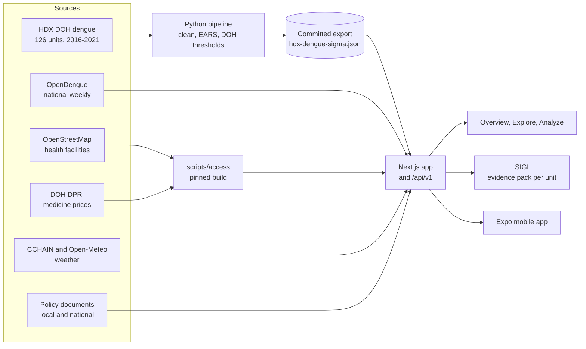

<div align="center">


# SIGMA

**Spatial Intelligence & Geographic Modeling for Action**

Dengue early-warning for the Philippines, looked at in hindsight:<br>
126 reporting units, two warning signals, and an assistant that cites its sources.

[](https://github.com/OrangeJuice023/datascience-2026/actions/workflows/validate.yml)


[**Open the live site**](https://datascience-2026.vercel.app) &nbsp;·&nbsp;
[API reference](https://datascience-2026.vercel.app/documentation) &nbsp;·&nbsp;
[Docs](docs/architecture.md) &nbsp;·&nbsp;
[Status and next steps](docs/next-steps.md)

</div>

<br>

> [!IMPORTANT]
> **Hackathon prototype.** SIGMA works on historical data (2016-2021). It is not real-time
> surveillance, it does not predict outbreaks or issue alerts, it never prescribes policy,
> and nothing in it is a validated public-health claim.

<br>

<div align="center">

| **126** | **261** | **15,586** | **17** |
| :---: | :---: | :---: | :---: |
| DOH reporting units | weeks of unit-level data | health facilities mapped | sourced policy records |
| <sub>59 provinces, 22 province remainders, 44 cities, Pateros</sub> | <sub>10 Jan 2016 to 3 Jan 2021</sub> | <sub>OpenStreetMap snapshot, 13 Oct 2026</sub> | <sub>local records for 4 cities, plus national law</sub> |

</div>

## The app

Three tabs, all on real data. Where a figure has no public source (medicine stock,
search demand, population per unit), SIGMA says "unknown" instead of guessing.

| | Tab | What you can do there |
| :---: | --- | --- |
| 🏠 | **Overview** &nbsp;`/` | See what SIGMA covers, how the two signals work, and where to go next. |
| 🗺️ | **Explore** &nbsp;`/explore` | Map every reporting unit week by week: reported cases, EARS signal, DOH threshold, and weekly weather for 12 cities. |
| 🔬 | **Analyze** &nbsp;`/analyze` | Three views on one place at a time, listed below. |

**Inside Analyze**

- **ACCESS** &nbsp;`/analyze/access`: hospitals, clinics, pharmacies and labs mapped in each
  reporting unit, and what DOH hospitals paid for dengue medicines (DPRI 2026).
- **Policy, with SIGI** &nbsp;`/analyze/policy`: ask about any reporting unit. SIGI answers
  only from that unit's evidence (Lab results, ACCESS figures, local and national policy),
  numbers every source, and the server rejects any citation from another place.
- **Lab** &nbsp;`/analyze/lab`: the national trend, each unit's weekly EARS and DOH marks,
  which signal came first each year, and how the methods work.

Also: **Data Sources** (`/data-sources`) lists every dataset with its coverage, licence and
credit line, and **Documentation** (`/documentation`) renders the API reference.

## How it works



### Two signals, read together

| Signal | Asks | Rule | Good at |
| --- | --- | --- | --- |
| **EARS** C1, C2, C3 | Is this week a sudden rise? | Compares a week with the 7 weeks before it (CDC EARS) | Timing: it fires early, but at every season's start |
| **DOH threshold** | Is this level high for the season? | Same week's mean over 3 prior years, + 1 SD for alert, + 2 SD for epidemic (PIDSR manual s. 5.3.5) | Size: it separates a big season from an ordinary one |

In the 2019 epidemic, EARS alarmed nationally on 26 May 2019, seven weeks before the DOH
national alert. That is why SIGMA always shows both. See the
[EARS QA report](docs/reports/dengue_ears_qa_report.pdf).

## Data

| Source | Licence | Coverage | Used in |
| --- | --- | --- | --- |
| [HDX Philippine Dengue Cases and Deaths](https://data.humdata.org/dataset/philippine-dengue-cases-and-deaths) (DOH Epidemiology Bureau data, via Cirrolytix) | CC BY | 126 reporting units, weekly, 2016-2021 | Explore, Lab, SIGI, `/dengue/signals`, `/dengue/units` |
| [OpenDengue v1.3](https://opendengue.org) | CC BY 4.0 | National, weekly, Dec 2012 to Nov 2023 (544 weeks, with gaps) | Lab, `/dengue/summary`, `/dengue/observations` |
| [HOT OpenStreetMap health facilities](https://data.humdata.org/dataset/hotosm_phl_health_facilities) | ODbL 1.0 | 15,586 facilities after cleaning, snapshot 2026-10-13 | ACCESS, SIGI |
| [DOH Drug Price Reference Index](https://dpri.doh.gov.ph/drug_search) 2026 | Philippine government work | Public-hospital prices for 4 dengue medicines (procurement year 2025) | ACCESS, SIGI |
| Policy evidence registry | Per document | 17 records, each tied to its source document | SIGI |
| [Project CCHAIN](https://data.humdata.org/dataset/project-cchain) climate | CC BY 4.0 | 12 cities, weekly, 2003-2022 | Explore → Environment |
| [Open-Meteo](https://open-meteo.com/) historical weather (ERA5) | CC BY 4.0 | Same 12 cities, weekly, 2008 to Oct 2026 | Explore → Environment |
| OCHA COD-AB, geoBoundaries, PSA PSGC | CC BY-IGO, CC BY 3.0 IGO, PSA terms | Region down to reporting unit | Boundaries and codes |

**Not available, so shown as unknown:** medicine stock per facility, what people search for,
and population per reporting unit.

<details>
<summary><b>Known data-quality limits</b></summary>

<br>

Detail in [docs/dengue-pipeline.md](docs/dengue-pipeline.md) and [docs/geo/](docs/geo/README.md).

- Reporting units are not provinces: 22 are province remainders. Values are only summed
  upward, never split.
- Missing weeks (for example 6 Jan 2019, for every unit) and 665 suspected cases↔deaths swap
  rows are **no data**, never zero.
- The meaning of the HDX `date` column, whether counts are by residence, and whether province
  rows exclude their cities are **unconfirmed** assumptions.
- Zeros cannot be told apart from "no report". Long zero runs and one-week spikes are flagged,
  not corrected. The national OpenDengue series has year-end reporting artefacts.
- The DOH thresholds use 3 prior years, the shortest the PIDSR manual allows. The official
  system may use 5 years and regional thresholds.
- A low facility count can mean low OpenStreetMap mapping, not low access.

</details>

## Getting started

You need Node.js 20+ and npm. The data pipeline also needs Python 3.12.

```bash
# Web app and API: http://localhost:3000
cd web && npm ci && npm run dev

# Mobile app (point it at the API in the app's Settings, or in mobile/.env)
cd mobile && npm ci && npm start

# Python pipeline (needs the raw files in data/raw/, see docs/dengue-pipeline.md)
pip install -r ml/requirements.txt
python ml/clean_dengue.py && python ml/ears.py
```

<details>
<summary><b>Environment variables</b> (all optional)</summary>

<br>

Copy each `.env.example` and fill in what you need. Never commit the real file.

| File | Variables | When unset |
| --- | --- | --- |
| [`web/.env.example`](web/.env.example) → `web/.env.local` | `GROQ_API_KEY` (server only), `GROQ_MODEL`, `CHAT_DISABLED`, `CHAT_PUBLIC_DISABLED` | SIGI answers `not_configured` |
| | `NEXT_PUBLIC_MAP_STYLE_URL`, `NEXT_PUBLIC_MAPTILER_KEY`, `NEXT_PUBLIC_MAPTILER_STYLE` | Maps use OpenStreetMap raster tiles |
| [`mobile/.env.example`](mobile/.env.example) → `mobile/.env` | `EXPO_PUBLIC_API_BASE_URL` (bundled into the app, never a secret) | `http://localhost:3000/api/v1` |
| [`ml/.env.example`](ml/.env.example) → `ml/.env` | `SUPABASE_URL`, `SUPABASE_SERVICE_ROLE_KEY`, `DATABASE_URL` | Unused today (no database yet) |

</details>

<details>
<summary><b>Repository layout</b></summary>

<br>

```
web/                       Next.js 16 (App Router), TypeScript, Tailwind; MapLibre, deck.gl, Recharts
  src/app/api/v1/          The versioned JSON API
  src/lib/api/             API services and the endpoint registry (feeds /api/v1 and /documentation)
  src/lib/analyze-chat/    SIGI: evidence pack, prompt, playbook
mobile/                    Expo + React Native client of the API
packages/sigma-contracts/  Request/response types shared by web and mobile
ml/                        Python pipeline: clean_dengue.py → ears.py → export_sigma_web.py
scripts/geo/               Geography build: HDX reporting units → COD-AB / PSA PSGC
scripts/access/            ACCESS build: OpenStreetMap facilities and DOH prices, hash-pinned
data/reference/            Small committed reference tables
data/raw/, data/processed/ Local only, git-ignored
docs/                      Architecture, API, pipeline, geography and data-model docs
```

The web app is both the UI and the API, and the mobile app is a second client. Analysis runs
offline in Python, and its output (`web/public/data/sigma/hdx-dengue-sigma.json`) is a
committed, generated file. There is no database yet. See [docs/architecture.md](docs/architecture.md).

</details>

## API

Read-only JSON at `/api/v1` ([live](https://datascience-2026.vercel.app/api/v1)), no
authentication. Every response is `{ data, meta }` or `{ error, meta }`, and `meta.status`
says what kind of data it carries.

| Endpoint | Returns | `meta.status` |
| --- | --- | --- |
| `GET /api/v1` | Endpoint index | `live` |
| `GET /api/v1/health` | Service status and configuration flags | `live` |
| `GET /api/v1/sources` | Source catalogue | `live` |
| `GET /api/v1/dengue/observations` | National weekly observations (OpenDengue) | `live` |
| `GET /api/v1/dengue/summary` | National weekly, monthly and yearly aggregates | `live` |
| `GET /api/v1/dengue/units` | Per reporting unit and epi year: cases, EARS weeks, DOH weeks | `live` |
| `GET /api/v1/dengue/signals` | EARS C1-C3 alarms per reporting unit and week | `live` |
| `GET /api/v1/access/units` | Mapped facilities and dengue burden per reporting unit | `live` |
| `GET /api/v1/access/medicines` | DOH medicine prices and formulary status | `live` |
| `GET /api/v1/access/metrics` | Retired; answers with empty lists | `not_connected` |
| `GET /api/v1/policy/info` | Units SIGI covers, evidence summary, AI disclosure | `live` |
| `GET /api/v1/policy/evidence` | The policy evidence records | `live` |
| `POST /api/v1/chat` | SIGI's answer with server-checked citations | `live`, or `not_configured` without a key |

```bash
curl "https://datascience-2026.vercel.app/api/v1/dengue/signals?locationId=quezon-city&limit=5"
curl "https://datascience-2026.vercel.app/api/v1/access/units?unitId=quezon-city"
```

`live` means real records from a connected source, which may still be historical. Full
reference: [docs/api.md](docs/api.md) and [`/documentation`](https://datascience-2026.vercel.app/documentation).

<details>
<summary><b>Notes for API integrators</b></summary>

<br>

- No endpoint takes credentials, and there are no API keys or quotas. This is a prototype
  deployment, not a hardened public API.
- SIGI's model key stays on the server. `/api/v1/chat` is rate limited (30 requests per 60 s
  per IP) and refuses with `not_configured` when no key is set.
- Branch on `meta.status`. Never treat `not_connected` or a missing week as "nothing found".
- Request limits (row caps, 16 KB body) are in [docs/api.md](docs/api.md#limits).

</details>

## Where things stand

| Part | State |
| --- | --- |
| Dengue cleaning, DOH thresholds, EARS C1-C3 | ✅ Run offline on 2016-2021 data, with QA reports ([docs/reports/](docs/reports/)) |
| EARS and DOH results in the app and API | ✅ Explore, Lab, `/dengue/units`, `/dengue/signals` |
| ACCESS | ✅ Real facilities and prices · ⛔ medicine stock has no public source |
| SIGI | ✅ Evidence pack per unit, server-checked citations · 🔜 answer quality to be live-tested with a model key |
| Policy coverage | 🔜 Local records for 4 of 126 units so far |
| Forecasting | ⛔ Not started: no fitted model yet ([research plan](planning/SIGMA_RESEARCH.md)) |

The full checklist, with what blocks each item, is in [docs/next-steps.md](docs/next-steps.md).

## Checks

```bash
cd web    && npm run lint && npm run typecheck && npm run test && npm run build
cd mobile && npm run lint && npm run typecheck && npm run test
python -m compileall -q ml
```

CI ([`validate.yml`](.github/workflows/validate.yml)) runs all of these on every pull request.
The web tests include a registry test that runs every documented API example against the real
handler, so `/documentation` cannot drift from the code.

## Documentation

| Document | Covers |
| --- | --- |
| [docs/architecture.md](docs/architecture.md) | System architecture |
| [docs/api.md](docs/api.md) | API endpoints, envelopes, limits and errors |
| [docs/dengue-pipeline.md](docs/dengue-pipeline.md) | Cleaning, DOH thresholds and EARS ([QA reports](docs/reports/)) |
| [docs/geo/](docs/geo/README.md) | Reporting units, geography method and data quality |
| [docs/environmental-covariates.md](docs/environmental-covariates.md) | Weather sources, comparability, covariate plan |
| [docs/access-data-model.md](docs/access-data-model.md) | ACCESS data model and open decisions |
| [docs/mobile.md](docs/mobile.md) | Expo client, API address, EAS builds |
| [docs/next-steps.md](docs/next-steps.md) | Status, next steps and data gaps |
| [AGENTS.md](AGENTS.md) | Rules for contributors and AI agents |

## Credits

Built for the Philippine Junior Data Science Challenge (PJDSC) 2026.

Data: DOH Epidemiology Bureau via HDX and Cirrolytix · OpenDengue · © OpenStreetMap
contributors (ODbL), via the Humanitarian OpenStreetMap Team · DOH Pharmaceutical Division
(DPRI) · OCHA COD-AB · geoBoundaries · PSA · Project CCHAIN · Open-Meteo.
