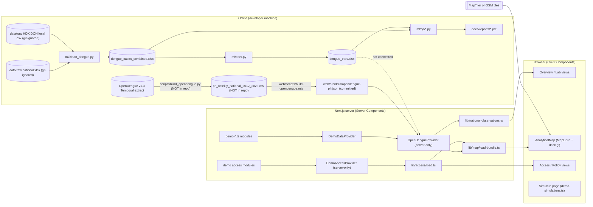
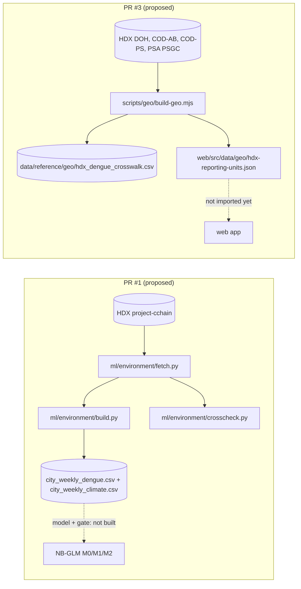

# SIGMA — Architecture

> Hackathon prototype. One real formal data source (OpenDengue, national,
> historical) flows through the web app; open-source signals, anomaly outputs,
> access data, policy content and simulations in the app are still demo data.
> A separate offline Python pipeline (`ml/`) computes DOH thresholds and EARS
> alarms, but its outputs are **not** connected to the app. Nothing here is a
> validated public-health claim.

Describes `main` at `8be0e89` (2026-10-19). Work in open pull requests is
listed separately under [Pending work in open pull requests](#pending-work-in-open-pull-requests)
and is **not** part of `main`.

Related: [system-flow.md](system-flow.md) (step-by-step flows),
[api.md](api.md) (interfaces and integrations),
[dengue-pipeline.md](dengue-pipeline.md) (Python pipeline detail),
[access-data-model.md](access-data-model.md) (ACCESS design),
[next-steps.md](next-steps.md) (backlog).

## Overview

SIGMA is organized around four conceptual modules:

1. **TRACE** — find and organize public-health signals.
2. **ANALYZE** — understand trends, anomalies and spatial patterns.
3. **SIMULATE** — explore assumption-driven scenarios.
4. **ACT** — support verification and LGU/public-health decision-making.

The repository holds two independent tracks that share no runtime code:

| Track | Path | Runtime | What it does today |
| --- | --- | --- | --- |
| Web app | `web/` | Next.js 16.3.5 (App Router), React 19.2, TypeScript 5, Tailwind 4 | Six pages; real OpenDengue national series plus demo data for everything else |
| Analysis pipeline | `ml/` | Python (pandas, numpy, openpyxl; QA reports with matplotlib and reportlab) | Cleans dengue data, computes DOH alert/epidemic thresholds and EARS C1/C2/C3, writes Excel outputs and PDF QA reports |

| Route | Page | Entry file | Evidence shown today |
| --- | --- | --- | --- |
| `/` | Overview | `web/src/app/page.tsx` | Formal summary (real) + demo signal landscape |
| `/explore` | Signal Explorer | `web/src/app/explore/page.tsx` | Analytical map: formal readout, demo signals/model/access/scenario |
| `/lab` | SIGMA Lab | `web/src/app/lab/page.tsx` | Real OpenDengue national series; demo LGU signal tabs |
| `/access` | ACCESS | `web/src/app/access/page.tsx` | Demo medicine availability, search demand, access gaps |
| `/simulate` | Simulate | `web/src/app/simulate/page.tsx` | Demo scenario curve (client-only) |
| `/policy` | Policy (ACT) | `web/src/app/policy/page.tsx` | Static demo assessment areas + ACCESS review prompts |

The sidebar also lists `/data-sources` and `/documentation` as "Soon"
(`web/src/lib/nav.ts`); they are disabled labels, not routes.

## Implemented architecture



Dashed edge: EARS output exists only as a local Excel file; the app's
`getAnomalyResults()` returns `[]`.

### Frontend

- **App Router, server-first.** Each `page.tsx` is a Server Component that
  loads data through a provider and passes compact, serializable props to a
  `"use client"` view (`overview-view.tsx`, `lab-view.tsx`,
  `explore-view.tsx`, `access-view.tsx`, `policy-view.tsx`). Exception:
  `/simulate` is a Client Component end to end.
- **Shell.** `web/src/app/layout.tsx` wraps every page in `AppShell`
  (`web/src/components/layout/app-shell.tsx`): desktop sidebar from `md`
  up, slide-over drawer below `md`. See [mobile.md](mobile.md).
- **Data states.** `web/src/components/ui/data-state-notice.tsx` defines
  `loading`, `no-data`, `partial-coverage`, `quality-warning`,
  `source-unavailable` and `model-not-fitted`; limitations are rendered,
  never hidden behind placeholder numbers.
- **Evidence badges.** `web/src/components/ui/evidence-badge.tsx` labels
  FORMAL / SIGNAL / MODEL / CONTEXT.
- **Server-side API layer: none.** There is no `web/src/app/api/` directory,
  no Route Handler and no Server Action. All server work happens while
  rendering Server Components. See [api.md](api.md).

### Provider architecture

```
UI (Server Components)
  ↓
DataProvider  (web/src/data/provider.ts)
  ├─ DemoDataProvider        demo signals, LGUs, trends; no observations
  ├─ OpenDengueProvider      real national observations + demo for the rest  ← in use
  └─ SupabaseDataProvider    future (not implemented)

AccessDataProvider  (web/src/data/access-provider.ts)
  ├─ DemoAccessProvider      synthetic medicines, facilities, inventory, searches  ← in use
  └─ SupabaseAccessProvider  future (design: access-data-model.md)
```

`OpenDengueProvider` (`web/src/data/opendengue-provider.ts`) and
`DemoAccessProvider` import `"server-only"`, so the source JSON and raw
search events cannot be bundled for the browser. `getAnomalyResults()`
returns `[]` until a model has actually been fitted on formal data; the UI
then shows "Model not yet fitted" instead of any score.

### Evidence categories (never mixed)

| Category | Type in `web/src/types/data.ts` | UI badge | Status |
| --- | --- | --- | --- |
| A. Formal health observation | `HealthObservation` | FORMAL | OpenDengue national weekly — **connected** |
| B. Event-based signal | `PublicHealthSignal` + `SignalSource` | SIGNAL | Demo only |
| C. Environmental / access covariate | planned `EnvironmentalCovariate` (type not yet defined) | CONTEXT | Environment planned; ACCESS demo |
| D. Geographic reference | `GeographicEntity` | — | Demo sample; every `psgcCode` is `null` |
| E. Model output | `AnomalyResult`, `ForecastResult`, `TrendSeries` | MODEL | Demo on signals; **none connected from formal data** |

A signal is not a case count, a model score is not a diagnosis, and a
national observation is never drawn as a sub-national layer. The `Measure`
union in `types/data.ts` makes it a type error to label a signal-derived
series as a case count, and every record carries `Provenance.isSample`.

The UI view models in `web/src/types/index.ts` (`Signal`, `LGU`,
`PolicyInsight`, `SimulationInputs`) are simpler than the data contracts and
are what the demo pages actually consume.

## Data flow: formal OpenDengue series (web)

```
OpenDengue v1.3 Temporal extract (WPRO)
        │  scripts/build_opendengue.py        (data track — NOT in this repository)
        ▼
data/processed/opendengue/ph_weekly_national_2012_2023.csv   (canonical, 544 rows — NOT in this repository)
        │  web/scripts/build-opendengue.mjs   (re-validates; deterministic; records input SHA-256)
        ▼
web/src/data/opendengue-ph.json               (committed frontend fixture)
        │  OpenDengueProvider (server-only)
        ▼
HealthObservation[]                           (typed, with per-row provenance)
        │  lib/national-observations.ts       (gap detection, stats, MMWR weeks)
        ▼
Server Components → compact serialized series → Client charts / map
```

The committed fixture records `sha256`, `retrievedAt` 2026-09-24, licence
CC BY 4.0 and the citation (Clarke J et al. Sci Data 2024;11:296). The
generator cannot be re-run from this repository alone because its input CSV
and the Python script that produces it are not committed
([next-steps.md](next-steps.md), P0-3).

### OpenDengue: which extract and why

The fixture and `build-opendengue.mjs` cite
`planning/OPENDENGUE_RECONCILIATION.md` as the reconciliation record. **That
file is not in this repository**; the summary below is what the generator
enforces. OpenDengue v1.3 publishes several extracts; for the Philippines:

| Extract | PH national weekly rows | Coverage |
| --- | --- | --- |
| National | 149 | 2013, 2022–2023 only (previously bundled; now removed) |
| Temporal (WPRO) | 544 | 2012-12-30 → 2023-11-25 |

SIGMA uses the Temporal extract, filtered to `ISO_A0 = PHL`, `T_res = Week`,
`S_res = Admin0`. The frontend generator refuses to write its fixture unless
the canonical CSV matches: 544 rows, 2012-12-30 → 2023-11-25, geography `ph` /
national, case definition `total`, sum 1,911,372, max 21,743, min 132, no
duplicate weeks, no zero values, every row a 7-day period. Known facts, all
surfaced in the Lab:

- The series is not continuous: 25 missing weeks in 7 gaps. Missing weeks are
  absent, never zero-filled or interpolated; charts break at them.
- Case definition: `Total` for every row.
- Weekly rows come from mixed upstream origins (record-id prefixes `WHOWPRO`, `MOH`).
- OpenDengue methods allow gaps of up to 6 weeks to be imputed upstream; the
  extract does not flag which weeks, if any, were.
- Annual totals are shown only for epi years with every week recorded.
- Sub-national PH rows (Admin1/Admin2) exist in the Temporal/Spatial extracts.
  They are **Phase 2** and not integrated. Observations carry their own
  `geographyId` / `geographicLevel`, so such a file can be added later without
  frontend redesign.

## Data flow: dengue cleaning, DOH thresholds and EARS (`ml/`)

Full detail in [dengue-pipeline.md](dengue-pipeline.md). Summary:

| Step | Script | Input | Output |
| --- | --- | --- | --- |
| Clean + DOH thresholds | `ml/clean_dengue.py` | `data/raw/Database for Dengue Cases at the National Level.xlsx`, `data/raw/Database for Dengue Cases at the Local Level.csv` | `data/processed/dengue_cases_combined.xlsx` (NATIONAL, LOCAL) |
| EARS C1/C2/C3 | `ml/ears.py` | `dengue_cases_combined.xlsx` | `data/processed/dengue_ears.xlsx` (NATIONAL, LOCAL, METHOD) |
| QA (cleaning) | `ml/qa/dengue_qa_report.py` | `dengue_cases_combined.xlsx` | `docs/reports/dengue_qa_report.pdf` |
| QA (EARS) | `ml/qa/ears_qa_report.py` + `ml/qa/ears_analysis.py` | both workbooks | `docs/reports/dengue_ears_qa_report.pdf` |

`data/raw/*` and `data/processed/*` are git-ignored, so a fresh clone cannot
run the pipeline until the raw files are supplied.

Source identity, checked during this audit on a teammate's local copy:

- The national workbook's 544 weekly values match
  `web/src/data/opendengue-ph.json` exactly on every week, so both tracks
  start from the same OpenDengue national series. `ml/` then restricts it to
  the local file's range (2016-01-10 → 2021-01-03, 261 weeks).
- The local CSV's SHA-256 starts `4e993553f10081b4`, the same file the
  geography track (PR #3) identifies as HDX "Philippine Dengue Cases and
  Deaths — DOH-Epi Dengue Data 2016-2021" (Cirrolytix, CC BY). This
  provenance is **not recorded anywhere on `main`**.
- **Known defect:** 586 rows have deaths > cases, part of the 665 suspected
  cases↔deaths swap rows identified by PR #3. `clean_dengue.py` drops
  `deaths` without checking, so these rows enter the DOH and EARS
  calculations as ordinary weeks ([next-steps.md](next-steps.md), P0-1).

## Geography

On `main`:

| Entity set | File | Status |
| --- | --- | --- |
| National `ph` | fixture rows, `sample/geographies.ts` | Used for the only real series |
| 12 demo LGUs (11 NCR cities + Antipolo) | `web/src/data/demo-lgus.ts` | Real names and approximate centroids; spatial frame for demo signals only |
| Sample hierarchy (ph → ncr/calabarzon → rizal → LGUs → 1 placeholder barangay) | `web/src/data/sample/geographies.ts` | `psgcCode: null` everywhere; not reconciled to PSGC |
| 126 HDX DOH reporting units in 17 source regions | `ml/clean_dengue.py` output | One `geographic_level = "local"`; no codes; name fixes only |

Rules already in code: an observation's `geographicLevel` always equals its
geography's level; NCR cities sit directly under the region
(`PARENT_BY_DEMO_PROVINCE`); signal geography is resolved independently of
formal-data geography.

The 126 units are **not** one administrative level: per PR #3 they are 59
whole provinces, 22 province *remainders* (province minus separately
reported cities), 44 cities and Pateros. On `main`, `ml/` outputs label a
remainder only by its province name (e.g. `ILOILO`), which reads as the whole
province. The canonical geography, crosswalk and proposed type changes are in
PR #3 (below), not on `main`.

## Map

MapLibre GL JS + deck.gl overlay (`web/src/components/maps/analytical/`).
Basemap resolution order (`web/src/lib/map/basemap.ts`):
`NEXT_PUBLIC_MAP_STYLE_URL` → `NEXT_PUBLIC_MAPTILER_KEY` (+
`NEXT_PUBLIC_MAPTILER_STYLE`, default `dataviz`) → key-less OpenStreetMap
raster fallback. A rejected style (HTTP error) switches to the fallback at
runtime; no WebGL shows a schematic fallback. 2D / 3D / Globe views, mode
registry (`web/src/lib/map/modes`), timeline and config-driven legend.

| Mode | `availability` | Evidence |
| --- | --- | --- |
| Signals | demo | public_health_signals |
| Disease | observed | health_observations — national readout, not a spatial layer |
| Anomaly | demo | model_output |
| Environment | planned | context — "No covariate data is connected yet" |
| Access | demo | context — see [access-data-model.md](access-data-model.md) |
| Simulation | demo | scenario |

## Event-signal pipeline (planned)

Typed contract in `web/src/lib/signals/pipeline.ts`; nothing is scraped yet.

```
News / RSS / GDELT → text extraction → disease extraction → location extraction
→ date/event extraction → deduplication → PSGC resolution
→ PublicHealthSignal → TRACE → spatiotemporal analysis
```

The formal-data provider is not responsible for any of these stages.

## Environment and runtime requirements

| Need | Where | Required? |
| --- | --- | --- |
| Node.js 20 (CI version), npm | `.github/workflows/validate.yml` | Yes, for `web/` |
| `NEXT_PUBLIC_MAPTILER_KEY`, `NEXT_PUBLIC_MAPTILER_STYLE`, `NEXT_PUBLIC_MAP_STYLE_URL` | `web/src/lib/map/basemap.ts` | Optional; OSM fallback without them. Public by design (inlined at build) |
| Python 3.12 (CI), `ml/requirements.txt` | `ml/` | Yes, for the pipeline |
| `SUPABASE_URL`, `SUPABASE_SERVICE_ROLE_KEY`, `DATABASE_URL` | `ml/.env.example` | Declared only; **no code reads them** |
| Raw dengue files in `data/raw/` | `ml/clean_dengue.py` | Yes, for the pipeline; not distributed |

There is no `web/.env.example`, no server-side secret, no API route and no
AI/LLM provider in the codebase.

## Model roadmap

| Level | Model | Status on `main` |
| --- | --- | --- |
| 1 | Seasonal / historical baseline (DOH 3-year alert/epidemic thresholds) | **Implemented offline** in `ml/clean_dengue.py`; not in the app |
| 2 | EARS C1/C2/C3 anomaly detection | **Implemented offline** in `ml/ears.py`, QA'd in `docs/reports/`; not in the app; affected by the swap-row defect. Farrington: not started |
| 3 | Forecasting baseline (SARIMA / Holt-Winters, rolling-origin backtests) | Not started |
| 4 | XGBoost or comparable ML benchmark | Not started |
| 5 | Spatiotemporal model (needs reconciled sub-national formal data) | Not started on `main`; method proposed in PR #3 |
| 6 | Scenario simulation (assumption-driven, never a forecast) | Demo prototype only (`web/src/data/demo-simulations.ts`) |
| — | Environmental covariate model ("Physics 3", CCHAIN) | Data preparation in PR #1; **no model fitted** |

Model code should consume `toObservationFrame()` (in
`web/src/lib/national-observations.ts`): one row per observation, ordered by
disease, geography, resolution and period — or the same frame exported for
the Python side. It must never read UI component state.

## Pending work in open pull requests

Seen as `refs/pull/*/head` on the upstream repository on 2026-10-19. Neither
is merged into `main`, so nothing below is available to the app or to a fresh
`main` checkout. Review state could not be checked (no GitHub CLI access).

| PR | Head | Author | Adds | Status of the work |
| --- | --- | --- | --- | --- |
| #1 | `992c9ae` | Kyla Pasion | `ml/environment/{sources,fetch,build,crosscheck}.py`, `docs/environmental-covariates.md` | CCHAIN + HDX download with manifest and hashes; aligned city-week dengue and climate tables for 12 CCHAIN cities (9 usable). **No model fitted, no scenario output.** Proposes NB-GLM M0/M1/M2, a rolling-origin evaluation gate and app output types for team sign-off. Uses `statsmodels`, which is not in `ml/requirements.txt` |
| #3 | `077ade4` | kyleflorian | `scripts/geo/*` (Node ≥ 20, no deps), `data/reference/geo/*`, `docs/geo/*`, `web/src/data/geo/hdx-reporting-units.json`, root `AGENTS.md` + `CLAUDE.md` | Canonical geography for the 126 HDX reporting units, matched to COD-AB v03 and PSA PSGC 3Q 2026; partition test (1,642/1,642 admin-3 units); swap-row and remainder findings; schema proposal (`kind`, `partialOf`, `excludes`, `analysisRegionId`, …). The fixture is not imported by any app code |



## Current limitations

- No database, authentication, API routes or background jobs.
- Only one real dataset reaches the UI; it ends 2023-11-25 and is national.
- `ml/` outputs live in git-ignored Excel files with no import path into
  `web/`.
- The OpenDengue fixture cannot be regenerated from the repo (missing script,
  CSV and reconciliation document).
- No automated tests in either track; CI runs lint, type-check, build and a
  Python compile check only.
- Deployment target (Vercel) is named in the README but has no configuration
  in the repo, and no deployment has been verified.
- Project tracking references a "hub" workbook (GEOGRAPHY, ENVIRONMENT,
  TRAINING_DATA tabs; a DATA_DICTIONARY) in PRs #1 and #3. It is not in the
  repository and was not inspected.

## Still open (needs team agreement)

- Supabase schema and hosting for processed records and model runs.
  (`web/src/types/data.ts` cites `docs/supabase-schema.md`, which does not
  exist.)
- How `ml/` outputs reach the app: committed fixture (as for OpenDengue),
  database table, or API.
- Geography contract: optional fields on `GeographicEntity` or a separate
  `ReportingUnit` type (PR #3 proposal); where `scripts/geo/` lives.
- Week convention: MMWR Sunday weeks (web, `ml/`) vs CCHAIN Monday dates
  (PR #1); the meaning of the HDX `date` column is unresolved.
- Typing of model outputs that are not case counts (PR #1 §10 Q3).
- Which open-source signal sources are onboarded first, and how.
- Sub-national formal data: reconciliation of OpenDengue region/province rows.
- Authentication model for LGU / public-health users.
- Whether a Policy Copilot (LLM) is in scope; none exists (see
  [policy-module.md](policy-module.md), [prompt.md](prompt.md)).
