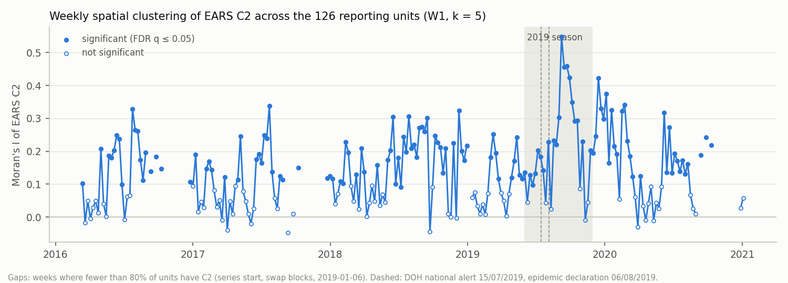
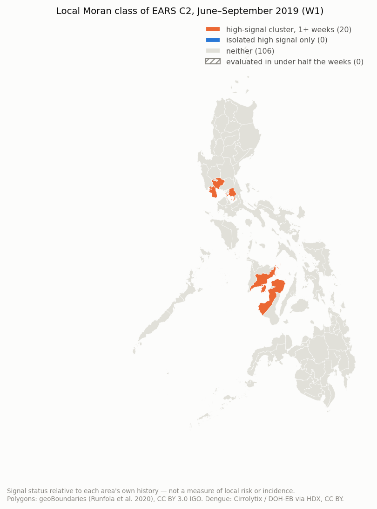

# Spatial analysis of EARS signals: results

> **Generated** by `ml/spatial/report.py` from `data/processed/spatial/` (`python -m spatial.run`);
> do not edit by hand. Method: [spatial-assessment-and-method.md](spatial-assessment-and-method.md) §4.2–4.4;
> what the results mean for SIGMA: §6.2 of that document. Hackathon prototype, not a validated
> public-health claim.

## In plain language

This report checks whether dengue warning signals (EARS C2, each place measured against its own
recent weeks) occur close together on the map more often than chance would give, whether alarms
in neighbouring places start at about the same time, and whether watching the 126 places one by
one warns earlier than watching the regional and national totals. Every test is repeated with
three definitions of "neighbour", with the data problems handled three ways, at province level,
and with the places' locations shuffled, which should make any real pattern vanish.

## 1. Setup

- Statistic: EARS C2 per reporting unit and week (`ml/ears.py`); raw counts are never compared
  across units. Re-running EARS on `dengue_cases_combined.xlsx` reproduces `dengue_ears.xlsx`
  with **0** differences.
- A week is analysed when at least 80% of units have C2; a unit whose
  neighbours all lack C2 that week is left out, and missing neighbours are not replaced.
- 999 permutations per test (seed 20261024); Benjamini–Hochberg FDR at
  q ≤ 0.05 over weeks (global) or over units within a week (local).
- "High-signal cluster" and "isolated high signal" also need the unit's own C2 > 1.0.
- Episodes: runs of EARS alarm weeks, gaps of up to 1 week merged.

| Weights | Definition | Neighbours (min / median / max) |
| --- | --- | --- |
| W1 (primary) | 5 nearest representative points | 5 / 5 / 5 |
| W2 | within 269.5 km (smallest band leaving no unit isolated) | 1 / 34.5 / 49 |
| W3 | shared border in the reporting-unit polygons; 1 city linked to its enclosing remainder; 12 units with no land neighbour linked to the nearest (batanes, biliran, bohol, camiguin, catanduanes, guimaras, marinduque, masbate, romblon, siquijor, sulu, tawi-tawi) | 1 / 3 / 11 |

Province level (MAUP check): 83 units (81 provinces, each with its cities; NCR as one
unit; Zamboanga City on its own), distance band 432.8 km.

## 2. Global clustering by week (step 4)



| analysis | weeks | significant | 2016–2018 | 2019–2021 | 2019 season | other seasons | median I |
| --- | --- | --- | --- | --- | --- | --- | --- |
| Units, W1 (primary) | 212 | 130 (61%) | 59% | 64% | 77% | 78% | 0.13 |
| Units, W2 | 212 | 98 (46%) | 43% | 50% | 62% | 58% | 0.044 |
| Units, W3 | 212 | 120 (57%) | 53% | 61% | 65% | 68% | 0.168 |
| Units, W1, ranks of C2 | 212 | 165 (78%) | 78% | 78% | 88% | 90% | 0.169 |
| Units, W1, swap rows swapped back | 248 | 159 (64%) | 63% | 65% | 77% | 77% | 0.134 |
| Units, W1, 2016 excluded | 176 | 111 (63%) | 60% | 66% | 77% | 78% | 0.13 |
| 83 full provinces, W1 | 212 | 118 (56%) | 56% | 55% | 54% | 66% | 0.137 |
| 83 full provinces, W2 | 212 | 51 (24%) | 28% | 18% | 31% | 39% | 0.017 |
| 83 full provinces, W3 | 212 | 61 (29%) | 28% | 30% | 27% | 34% | 0.159 |

Seasons are June–November. Correlation of the weekly Moran's I series: W1 vs W2
0.67, W1 vs W3 0.866, units vs provinces (W1) 0.749
over 212 common weeks. National epidemic declaration week (2019-08-04): Moran's I
0.228, q = 0.0031.

## 3. Local clusters (step 5)

| analysis | period | unit-weeks | high-signal cluster | isolated high | Gi* hot spots | …also high cluster | weeks with a cluster |
| --- | --- | --- | --- | --- | --- | --- | --- |
| W1 (primary) | 2016–2018 | 14965 | 35 | 4 | 8 | 8 | 16 |
| W1 (primary) | 2019–2021 | 11500 | 85 | 1 | 67 | 67 | 17 |
| W2 | 2016–2018 | 14965 | 846 | 236 | 903 | 744 | 50 |
| W2 | 2019–2021 | 11494 | 409 | 92 | 381 | 350 | 34 |
| W3 | 2016–2018 | 14923 | 24 | 5 | 16 | 13 | 12 |
| W3 | 2019–2021 | 11478 | 20 | 1 | 16 | 16 | 7 |
| W1, swap rows swapped back | 2016–2018 | 17945 | 46 | 4 | 18 | 18 | 16 |
| W1, swap rows swapped back | 2019–2021 | 12995 | 83 | 0 | 67 | 67 | 16 |
| W1, 2016 excluded | 2016–2018 | 10499 | 29 | 3 | 10 | 10 | 11 |
| W1, 2016 excluded | 2019–2021 | 11509 | 76 | 3 | 63 | 63 | 15 |

Agreement of the three-way class between weights (unit-weeks evaluated under both):
W1 vs W2 κ = 0.109 (96 unit-weeks are a
high-signal cluster under both; 120 under W1, 1254 under W2);
W1 vs W3 κ = 0.227 (20 both;
120 W1, 44 W3).



Units by class, June–September 2019 (W1): neither 106, high-signal cluster, 1+ weeks 20.

## 4. Space-time clustering of alarm starts (step 6, Knox)

Pairs of EARS episode starts in neighbouring units (W, symmetrised) and within
2 weeks of each other, against 999 permutations of start weeks across
all weeks, or only within the same epi year (removes year-to-year differences).

| variant | weights | period | null | events | observed | expected | ratio | p |
| --- | --- | --- | --- | --- | --- | --- | --- | --- |
| primary | W1 | all | all weeks | 1131 | 1311 | 1074 | 1.22 | 0.001 |
| primary | W1 | all | within epi year | 1131 | 1311 | 1118 | 1.17 | 0.001 |
| primary | W1 | 2016-2018 | all weeks | 713 | 822 | 696 | 1.18 | 0.001 |
| primary | W1 | 2016-2018 | within epi year | 713 | 822 | 714 | 1.15 | 0.001 |
| primary | W1 | 2019-2021 | all weeks | 418 | 486 | 393 | 1.24 | 0.001 |
| primary | W1 | 2019-2021 | within epi year | 418 | 486 | 400 | 1.22 | 0.002 |
| primary | W2 | all | all weeks | 1131 | 6060 | 5542 | 1.09 | 0.001 |
| primary | W2 | all | within epi year | 1131 | 6060 | 5594 | 1.08 | 0.001 |
| primary | W2 | 2016-2018 | all weeks | 713 | 3863 | 3459 | 1.12 | 0.001 |
| primary | W2 | 2016-2018 | within epi year | 713 | 3863 | 3528 | 1.1 | 0.001 |
| primary | W2 | 2019-2021 | all weeks | 418 | 2185 | 2084 | 1.05 | 0.057 |
| primary | W2 | 2019-2021 | within epi year | 418 | 2185 | 2060 | 1.06 | 0.012 |
| primary | W3 | all | all weeks | 1131 | 759 | 583 | 1.3 | 0.001 |
| primary | W3 | all | within epi year | 1131 | 759 | 607 | 1.25 | 0.001 |
| primary | W3 | 2016-2018 | all weeks | 713 | 471 | 365 | 1.29 | 0.001 |
| primary | W3 | 2016-2018 | within epi year | 713 | 471 | 376 | 1.25 | 0.001 |
| primary | W3 | 2019-2021 | all weeks | 418 | 286 | 231 | 1.24 | 0.001 |
| primary | W3 | 2019-2021 | within epi year | 418 | 286 | 231 | 1.24 | 0.001 |

## 5. Local versus aggregate lead time (step 7)

For each regional DOH-threshold episode (2+ consecutive weeks; onset counted only when the week
before was evaluated and below the threshold), the first EARS alarm in the 8 weeks
before onset through the episode's end: on the regional series itself, and from its member units
under three rules. "Calibrated count": more units alarming in the same week than in 95% of
off-season (December–May) weeks of 2016–2018 (median 2 for
regions). "Fires in quiet windows": share of 9-week windows in 2019–2021 that
touch no episode in which the rule fires anyway.

| variant | threshold | episodes | rule | found | median lead (wk) | fires in quiet windows | earlier / same / later than regional | only local found |
| --- | --- | --- | --- | --- | --- | --- | --- | --- |
| primary | epidemic | 50 | regional series itself | 37 | 6.0 | 34% |  |  |
| primary | epidemic | 50 | any member unit | 47 | 8.0 | 71% | 17 / 20 / 0 | 10 |
| primary | epidemic | 50 | 2+ member units same week | 42 | 5.5 | 43% | 10 / 20 / 7 | 5 |
| primary | epidemic | 50 | calibrated count of units | 38 | 4.5 | 27% | 4 / 19 / 13 | 2 |
| primary | alert or epidemic | 43 | regional series itself | 34 | 5.0 | 34% |  |  |
| primary | alert or epidemic | 43 | any member unit | 39 | 8.0 | 71% | 17 / 17 / 0 | 5 |
| primary | alert or epidemic | 43 | 2+ member units same week | 35 | 5.0 | 41% | 10 / 19 / 4 | 2 |
| primary | alert or epidemic | 43 | calibrated count of units | 32 | 2.5 | 25% | 2 / 17 / 13 | 0 |
| swapped_back | epidemic | 49 | regional series itself | 37 | 6.0 | 35% |  |  |
| swapped_back | epidemic | 49 | any member unit | 46 | 8.0 | 73% | 17 / 20 / 0 | 9 |
| swapped_back | epidemic | 49 | 2+ member units same week | 41 | 5.0 | 44% | 10 / 20 / 7 | 4 |
| swapped_back | epidemic | 49 | calibrated count of units | 37 | 4.0 | 29% | 4 / 19 / 13 | 1 |
| no_2016 | epidemic | 47 | regional series itself | 36 | 5.5 | 34% |  |  |
| no_2016 | epidemic | 47 | any member unit | 46 | 8.0 | 70% | 17 / 19 / 0 | 10 |
| no_2016 | epidemic | 47 | 2+ member units same week | 39 | 5.0 | 43% | 10 / 18 / 8 | 3 |
| no_2016 | epidemic | 47 | calibrated count of units | 37 | 4.0 | 30% | 6 / 18 / 11 | 2 |

National (sum of all 126 units, complete weeks only). Its own DOH-threshold episode starts in the
first week thresholds exist, so its onset is censored; the DOH announcements are used instead, with
the window starting 2019-03-03.

| variant | threshold | onset | k_cal | national series first alarm | units over calibrated count | national lead (wk) | local lead (wk) |
| --- | --- | --- | --- | --- | --- | --- | --- |
| primary | DOH national alert announced 15/07/2019 | 2019-07-14 | 24 | 2019-06-09 | 2019-06-02 | 5.0 | 6.0 |
| primary | DOH national epidemic declared 06/08/2019 | 2019-08-04 | 24 | 2019-06-09 | 2019-06-02 | 8.0 | 9.0 |
| swapped_back | DOH national alert announced 15/07/2019 | 2019-07-14 | 24 | 2019-06-09 | 2019-06-02 | 5.0 | 6.0 |
| swapped_back | DOH national epidemic declared 06/08/2019 | 2019-08-04 | 24 | 2019-06-09 | 2019-06-02 | 8.0 | 9.0 |
| no_2016 | DOH national alert announced 15/07/2019 | 2019-07-14 | 23 | 2019-06-09 | 2019-06-02 | 5.0 | 6.0 |
| no_2016 | DOH national epidemic declared 06/08/2019 | 2019-08-04 | 23 | 2019-06-09 | 2019-06-02 | 8.0 | 9.0 |

## 6. Validation

**Weights and MAUP**: tables in §2–§4 (W2, W3, province rows).

**Data quality.** Swap rows swapped back and 2016 excluded:

| variant | weights | period | null | events | observed | expected | ratio | p |
| --- | --- | --- | --- | --- | --- | --- | --- | --- |
| primary | province W1 | all | all weeks | 736 | 845 | 680 | 1.24 | 0.001 |
| primary | province W1 | all | within epi year | 736 | 845 | 712 | 1.19 | 0.001 |
| primary | province W1 | 2016-2018 | all weeks | 451 | 495 | 417 | 1.19 | 0.002 |
| primary | province W1 | 2016-2018 | within epi year | 451 | 495 | 428 | 1.16 | 0.001 |
| primary | province W1 | 2019-2021 | all weeks | 285 | 347 | 276 | 1.26 | 0.002 |
| primary | province W1 | 2019-2021 | within epi year | 285 | 347 | 283 | 1.23 | 0.001 |
| primary | province W2 | all | all weeks | 736 | 4124 | 3907 | 1.06 | 0.001 |
| primary | province W2 | all | within epi year | 736 | 4124 | 3992 | 1.03 | 0.023 |
| primary | province W2 | 2016-2018 | all weeks | 451 | 2550 | 2385 | 1.07 | 0.003 |
| primary | province W2 | 2016-2018 | within epi year | 451 | 2550 | 2453 | 1.04 | 0.034 |
| primary | province W2 | 2019-2021 | all weeks | 285 | 1563 | 1543 | 1.01 | 0.294 |
| primary | province W2 | 2019-2021 | within epi year | 285 | 1563 | 1536 | 1.02 | 0.194 |
| primary | province W3 | all | all weeks | 736 | 487 | 363 | 1.34 | 0.001 |
| primary | province W3 | all | within epi year | 736 | 487 | 376 | 1.29 | 0.001 |
| primary | province W3 | 2016-2018 | all weeks | 451 | 280 | 216 | 1.3 | 0.001 |
| primary | province W3 | 2016-2018 | within epi year | 451 | 280 | 221 | 1.27 | 0.001 |
| primary | province W3 | 2019-2021 | all weeks | 285 | 205 | 152 | 1.35 | 0.003 |
| primary | province W3 | 2019-2021 | within epi year | 285 | 205 | 153 | 1.34 | 0.001 |
| swapped_back | W1 | all | all weeks | 1173 | 1364 | 1108 | 1.23 | 0.001 |
| swapped_back | W1 | all | within epi year | 1173 | 1364 | 1150 | 1.19 | 0.001 |
| swapped_back | W1 | 2016-2018 | all weeks | 734 | 836 | 709 | 1.18 | 0.001 |
| swapped_back | W1 | 2016-2018 | within epi year | 734 | 836 | 722 | 1.16 | 0.001 |
| swapped_back | W1 | 2019-2021 | all weeks | 439 | 525 | 419 | 1.25 | 0.001 |
| swapped_back | W1 | 2019-2021 | within epi year | 439 | 525 | 428 | 1.23 | 0.001 |
| no_2016 | W1 | all | all weeks | 912 | 1047 | 854 | 1.23 | 0.001 |
| no_2016 | W1 | all | within epi year | 912 | 1047 | 897 | 1.17 | 0.001 |
| no_2016 | W1 | 2016-2018 | all weeks | 493 | 556 | 475 | 1.17 | 0.002 |
| no_2016 | W1 | 2016-2018 | within epi year | 493 | 556 | 494 | 1.13 | 0.003 |
| no_2016 | W1 | 2019-2021 | all weeks | 419 | 488 | 394 | 1.24 | 0.001 |
| no_2016 | W1 | 2019-2021 | within epi year | 419 | 488 | 400 | 1.22 | 0.001 |

**Negative control.** Unit locations shuffled 20 times (each series kept intact),
199 permutations each: weekly Moran's I significant after FDR in 0%
of weeks on average (max 0%); raw p ≤ 0.05 in 5%
(max 8%). Knox ratio 1.011
(range 0.935–1.095); within-year Knox
p ≤ 0.05 in 2 of 20 shuffles.

**Out of time.** No parameter was tuned; every table splits 2016–2018 from 2019–2021. The lead-time
calibration uses 2016–2018 only.

**External plausibility** (qualitative; there are no outbreak labels). Units in a high-signal
cluster at least once, 2019-05-01 to 2019-07-14 (W1), by the region's class in the DOH announcement of
15/07/2019:

| DOH 15/07/2019 class | regions | units | units_in_cluster | share |
| --- | --- | --- | --- | --- |
| alert | 9 | 55 | 3 | 0.055 |
| epidemic | 4 | 28 | 4 | 0.143 |
| not named | 4 | 43 | 0 | 0.0 |

Places named in news reports (8 weeks up to the event):

| place | event | date | weeks_high_cluster | weeks_isolated_high | weeks_evaluated |
| --- | --- | --- | --- | --- | --- |
| ILOILO CITY | outbreak declared | 2019-07-05 | 0 | 0 | 8 |
| CAPIZ | outbreak declared | 2019-07-12 | 0 | 0 | 8 |
| GUIMARAS | outbreak declared | 2019-07-12 | 1 | 0 | 8 |
| ILOILO | state of calamity | 2019-07-16 | 1 | 0 | 8 |
| ZAMBOANGA SIBUGAY | state of calamity | 2019-07-17 | 0 | 0 | 8 |
| ILOILO CITY | state of calamity | 2019-07-26 | 1 | 0 | 8 |

## 7. Reproduce

```bash
cd ml
python ears.py                 # if dengue_ears.xlsx is missing (after clean_dengue.py)
python -m spatial.run          # about 1.5 minutes
python -m spatial.report
python -m unittest discover -s tests
```

Inputs: `data/processed/dengue_cases_combined.xlsx`, `data/processed/dengue_ears.xlsx`,
`data/reference/geo/hdx_dengue_crosswalk.csv`, `web/public/geo/hdx-reporting-units.geojson`,
and for the swapped-back check the raw HDX file (hash-checked against `scripts/geo/sources.json`).
