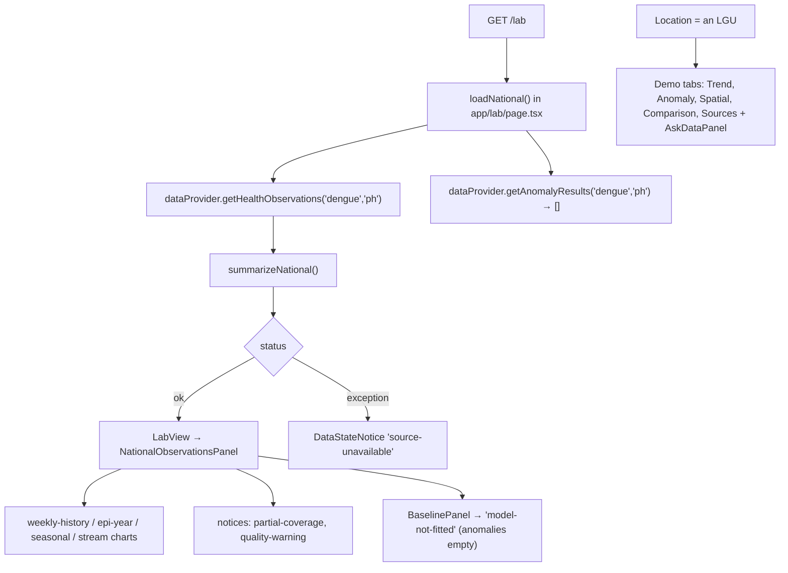
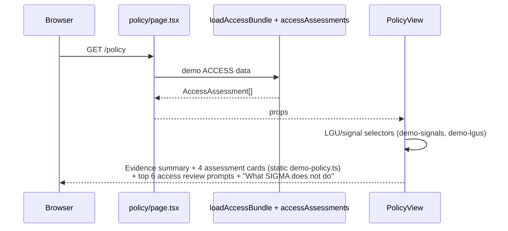
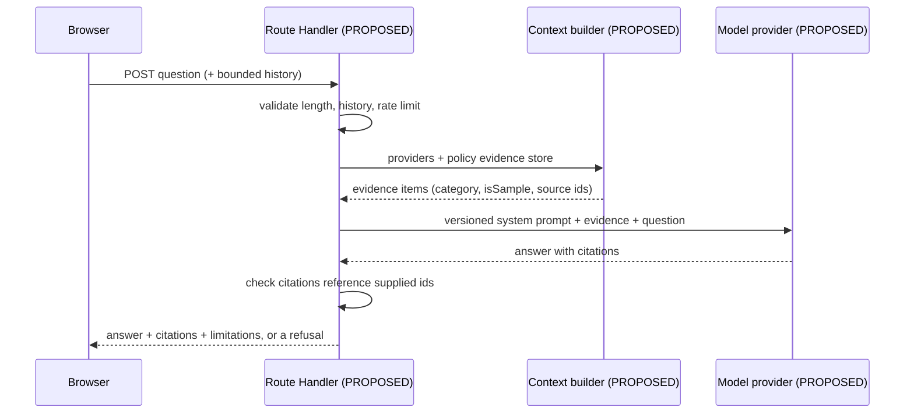
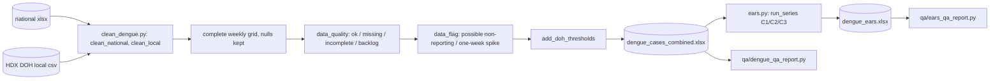

# SIGMA — System flows

Step-by-step flows for what a user can actually do on `main` (`8be0e89`,
2026-10-19). Components and functions are named so they can be found with a
text search. Structure: [architecture.md](architecture.md). Interfaces:
[api.md](api.md).

Legend: **Implemented** = runs today · **Demo** = runs on synthetic data ·
**Proposed** = does not exist.

## Shared pattern: Server Component → client view

Every route except `/simulate` follows the same path:

```mermaid
sequenceDiagram
  participant B as Browser
  participant P as page.tsx (Server Component)
  participant D as Provider / loader (server-only)
  participant V as *-view.tsx (Client Component)
  B->>P: GET /route
  P->>D: dataProvider.* / loadMapBundle / loadAccessBundle
  D-->>P: in-memory records (fixture JSON or demo modules)
  P->>P: shape (summarizeNational, accessAssessments, ...)
  P-->>B: HTML + serialized props
  B->>V: hydrate; filters and tabs are client state only
```

There are no client-side data requests after the page loads. Changing a
filter re-renders from props already in the browser. The basemap tiles are
the only network traffic.

## 1. Opening the app (Overview `/`) — Implemented (mixed real + demo)

| Item | Detail |
| --- | --- |
| Entry point | `web/src/app/page.tsx` → `OverviewPage` |
| Components | `AppShell`, `TopBar`, `SidebarContent`, `OverviewView`, `StatCard`, `ProcessStrip`, `MapPanel`, `SignalTable` |
| Functions | `loadFormalSummary()` → `dataProvider.getHealthObservations("dengue", "ph", { temporalResolution: "weekly" })` → `summarizeNational()` |
| Data | `web/src/data/opendengue-ph.json` (real); `DEMO_SIGNALS` (demo) |
| Transformations | Count of recorded weeks, first/last dates, missing weeks (`expected − recorded`), latest observation |
| Result | Stat cards for formal weeks and latest observation (FORMAL badge), "Demo only" signals, model status; demo signal map and table |
| Failure / fallback | Any error in `loadFormalSummary` returns `null`, and the card reads "Formal observations: Unavailable". Demo content still renders |

Also on every page: the top bar badge "Prototype · mixed real and demo data",
and the sidebar status block (Formal data: OpenDengue · static; Signals:
Demo data; Models: Not fitted).

## 2. Viewing dengue observations (Lab `/lab`) — Implemented (national), Demo (LGU)



| Item | Detail |
| --- | --- |
| Entry point | `web/src/app/lab/page.tsx`; streaming placeholder `web/src/app/lab/loading.tsx` |
| Components | `LabView`, `NationalObservationsPanel`, `web/src/components/lab/national/*` (`weekly-history-chart`, `epi-year-chart`, `seasonal-profile-chart`, `stream-chart`, `baseline-panel`); demo tabs in `web/src/components/lab/*-tab.tsx` |
| Data | OpenDengue national weekly (544 rows) for "Philippines · national (observed)"; demo trends and signals for the LGU options |
| Transformations | `summarizeNational()`: continuous weekly timeline with `value: null` for missing weeks, gap list, MMWR epi weeks (`epiWeek`), epi-year completeness, seasonal median/min/max, origins by year |
| Result | Charts break at the 25 missing weeks. Annual totals only for complete epi years. Evidence badge FORMAL vs SIGNAL follows the location |
| Failure / fallback | Exception → "Formal data source unavailable … No observations are shown rather than substitute values." Empty weekly series → "No weekly observations available". No model → "Model not yet fitted" |

## 3. Inspecting a data-quality warning — Implemented

Notices come from `DataStateNotice` (`web/src/components/ui/data-state-notice.tsx`):

| State | Where it appears today | Trigger |
| --- | --- | --- |
| `loading` | `app/lab/loading.tsx` | While the Lab Server Component renders |
| `source-unavailable` | `LabView` | `loadNational()` caught an exception |
| `no-data` | `NationalObservationsPanel` | Zero weekly observations |
| `partial-coverage` | `NationalObservationsPanel` | Always shown with the count of missing weeks |
| `quality-warning` | `NationalObservationsPanel` | Always shown: mixed upstream origins, possible upstream imputation |
| `model-not-fitted` | `BaselinePanel` | `anomalies` is empty (always, today) |

`ml/` quality flags (`data_quality`, `data_flag`, `ears_note`, `doh_note`)
are **not** shown in the app. They exist only in the offline Excel outputs
and the QA PDFs ([dengue-pipeline.md](dengue-pipeline.md)).

## 4. Maps and signals (Explore `/explore`) — Implemented map, Demo layers

| Item | Detail |
| --- | --- |
| Entry point | `web/src/app/explore/page.tsx` → `loadMapBundle()` |
| Components | `ExploreView`, `AnalyticalMap` (dynamic import of `MapCanvas`, client only), `MapTimeline`, `AnalyticalLegend`, `LocationDetailPanel`, `AccessDetailPanel` |
| Functions | `MAP_MODES` / `getMapMode` (`web/src/lib/map/modes/index.ts`), `applySignalFilters`, `resolveBasemap()` |
| Data | Demo signals, LGUs, trends, neighbours, scenario, access; `nationalWeekly` from OpenDengue |
| Result | Six modes. Disease mode is `observed` and shows a national readout, not polygons. Signals, Anomaly, Access and Simulation are labelled demo. Environment is `planned` and shows its `unavailableReason` |
| Failure / fallback | Basemap HTTP error → OSM fallback plus a notice. No key → OSM, with the hint "set NEXT_PUBLIC_MAPTILER_KEY…". No WebGL → `MapFallback` schematic view "without basemap, 3D or globe" |

## 5. ACCESS (`/access`) — Demo

`web/src/app/access/page.tsx` → `loadAccessMapBundle()` →
`DemoAccessProvider` → `facilityStates` / `computeAccessMetrics`
(`web/src/lib/access/metrics.ts`) → `packAccessBundle` → `AccessView`, plus
`accessAssessments()`. Raw search events never leave the server. Rules and
thresholds: [access-data-model.md](access-data-model.md).

## 6. Policy (`/policy`) — Demo; question flow Proposed

### 6a. What happens today



There is no question input and no server call after load. Details:
[policy-module.md](policy-module.md).

### 6b. Submitting a question to a Policy Copilot — **Proposed, does not exist**

No route, validation, context builder or AI provider exists. If one is
approved ([next-steps.md](next-steps.md) P1-6), the intended path is:



Requirements: [prompt.md](prompt.md) §3 and [policy-module.md](policy-module.md) §6.

## 7. Environmental analysis and scenarios

| Feature | State | Where |
| --- | --- | --- |
| Environment map mode | **Planned** placeholder: "No covariate data is connected yet" | `web/src/lib/map/modes/index.ts` (`ENVIRONMENT_MODE`) |
| CCHAIN download, alignment and city-week tables | **PR #1 only**, offline Python, not on `main` | `ml/environment/*.py` in `992c9ae` |
| Climate–dengue model and backtest | **Not started** | PR #1 `docs/environmental-covariates.md` §5, §7 |
| Climate scenario tool | **Proposed, gated** on the model passing §7 | PR #1 §6 |
| Simulate page | **Demo**: deterministic curve, client only | below |

### Simulate (`/simulate`) — Demo

`web/src/app/simulate/page.tsx` (Client Component). `SimulationControls`
update `SimulationInputs`, and `generateDemoTrajectory()`
(`web/src/data/demo-simulations.ts`) computes a deterministic curve.
**Run** animates `dayCursor` every 90 ms. `MapPanel` shows the origin and up
to 8 nearest demo LGUs as "Modeled reach (demo)". `ScenarioSummary` and
`AssumptionsSection` explain the assumptions. There is no server call and no
fitted model. The code comment reads: "not a validated epidemiological model
and should never be presented as a forecast."

## 8. Offline pipeline flow (`ml/`) — Implemented, not connected



Failure behaviour: no error handling beyond pandas exceptions. Missing raw
files raise `FileNotFoundError`. Known defect: swap rows are not detected
([next-steps.md](next-steps.md) P0-1).

## 9. Errors, missing data and unavailable integrations — summary

| Situation | Behaviour today |
| --- | --- |
| Formal fixture unreadable | Overview: "Unavailable" card. Lab: `source-unavailable` notice. No substitute values |
| Missing weeks | `null` points; charts break; counted and disclosed |
| Model not fitted | `model-not-fitted` notice; "Not fitted" in the sidebar |
| No MapTiler key / rejected style | OSM raster fallback with a visible note |
| No WebGL | Schematic `MapFallback` |
| Planned map mode | Disabled with "Planned" tag and reason |
| Unknown LGU/disease combination | "No demo data available for this combination" (Policy) |
| API errors | Not applicable: no API exists |
| Route errors | No custom `error.tsx` or `not-found.tsx`; Next.js defaults apply |
